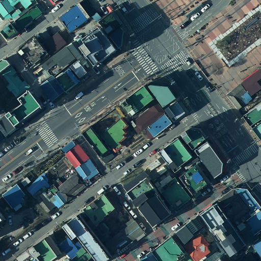
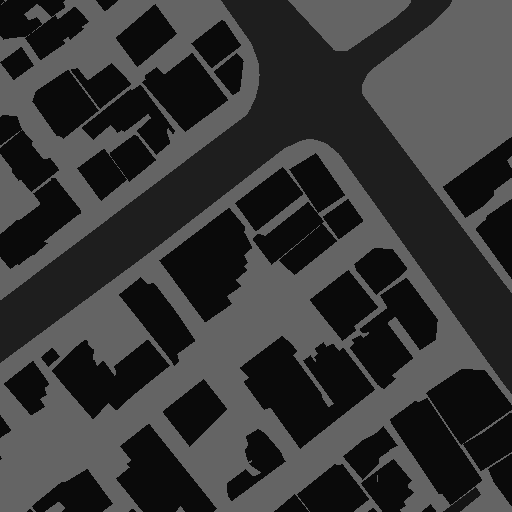

# AI Hub 자료를 학습용 마스크로 만들기

AI Hub에서는 같은 장소의 파일 두 장을 제공합니다. 하늘에서 찍은 사진 `image.tif`와, 그 사진의 정답이 들어 있는 `mask.tif`입니다.

`image.tif`는 실제 항공사진입니다.

`mask.tif`는 마스크 이미지

`src/extract_mask_by_class.py`를 실행하면, 마스크 안의 번호를 헥사 코드로 찾아서 건물과 도로만 남깁니다. 그 둘을 제외한 나머지 종류는 모두 배경이 됩니다.

헥사 코드 `#0A0A0A`은 건물입니다. `#1E1E1E`은 도로입니다. 코드는 새 마스크를 먼저 전부 배경으로 채운 뒤, 이 두 색과 정확히 같은 곳만 건물과 도로로 다시 적습니다. 나머지는 배경으로 남습니다.

| 찾는 헥사 코드 | 새 마스크 | 의미 |
| --- | --- | --- |
| `#0A0A0A` | 1 | 건물 |
| `#1E1E1E` | 2 | 도로 |
| 찾지 않음 | 0 | 배경 |

이렇게 해서 배경, 건물, 도로만 있는 `D_mask.tif`가 만들어집니다. 배경은 0, 건물은 1, 도로는 2입니다. 

학습할 때는 `image.tif`를 보여주고, 정답으로 이 `D_mask.tif`를 사용합니다.
